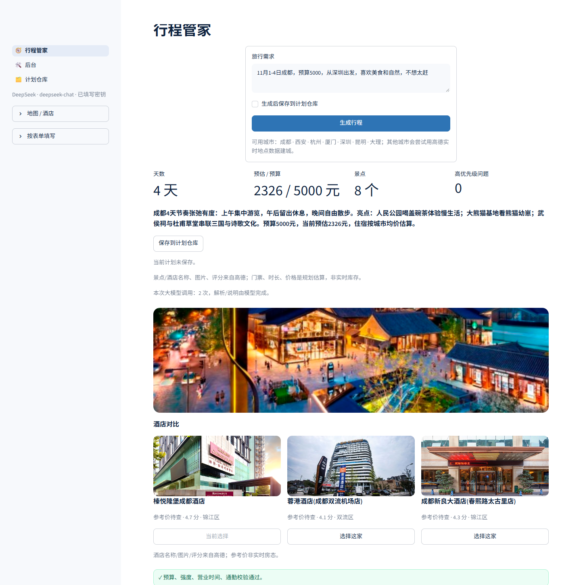
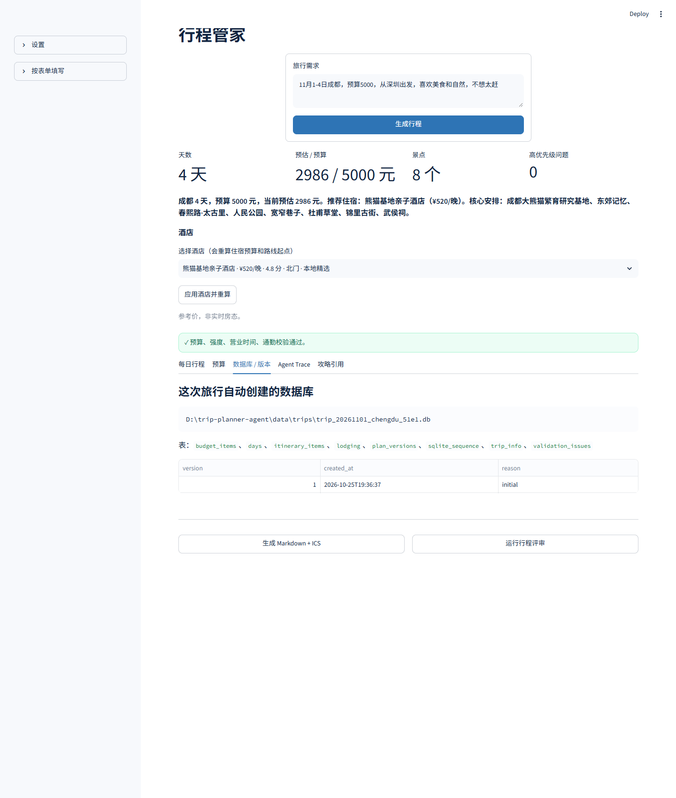

# 行程管家

> 会自己建旅行数据库、会算预算、会校验路线可行性的旅行规划 Agent。



## 先配置 API（必读）

仓库里**不包含任何 API Key**。第一次运行先复制配置：

```powershell
copy .env.example .env
```

然后至少填一个模型 Key：

```text
OPENAI_API_KEY=你的模型Key
OPENAI_BASE_URL=https://api.deepseek.com/v1
OPENAI_MODEL=deepseek-chat
```

也可以在高德开放平台申请 Web服务 Key：

```text
AMAP_API_KEY=你的高德Web服务Key
```

说明：

- **没有配置任何模型 Key 时，系统默认按 OpenAI 配置展示，但不会发起请求**，会自动回退到规则解析 / 模板说明。
- 没有高德 Key 时，酒店/餐厅/图片会回退到本地演示数据或 Mock 路线。
- 不要把 `.env` 提交到 Git；仓库已经忽略它。

**行程管家**把一句旅行需求变成一份可执行、可修改、可导出的行程：

```text
自然语言需求
→ LLM 解析城市/日期/预算/偏好/节奏
→ 为这次旅行创建独立 SQLite
→ 查本地 POI 库 + 攻略 RAG
→ 推荐酒店并写入住宿预算
→ 生成每日路线
→ 校验预算/通勤/营业时间/强度
→ 不通过就自动修复
→ 保存版本，导出 Markdown / ICS
```

## 为什么不是直接问 AI

直接问 AI 能给出“看起来不错”的行程，但常见问题是：

- 一天塞 5 个景点，路上根本来不及；
- 预算随口一加，住宿、交通、门票没有对齐；
- 改了一版，上一版没了；
- 不记得你不吃辣、不想早起、带老人；
- 不能导出日历，也不能持续更新预订状态。

行程管家的差异是：

| 直接问 AI | 行程管家 |
|---|---|
| 一次性文本 | 每次旅行一个 SQLite，可回看、可修改 |
| LLM 自由发挥 | 预算/时间/营业时间由确定性代码校验 |
| 没有版本 | `plan_versions` 保存每次修改 |
| 没有证据 | 攻略 RAG 返回引用片段 |
| 酒店只是列表 | 推荐 3 家，选中后重算住宿预算和路线起点 |
| 不能复用 | MCP 把 POI/酒店/路线/天气工具暴露给其他 Agent |
| 不评估 | 5 条 golden request + Judge 评分 |

## 三个页面

| 页面 | 作用 |
|---|---|
| 行程管家 | 输入需求、生成行程、选酒店、导出；内置 6 城 + 高德动态城市 |
| 后台 | 模型/密钥、数据库、调用记录、攻略引用都集中在这里；主页面不暴露密钥 |
| 计划仓库 | 生成前可选是否保存；保存后落独立 SQLite，可打开历史计划 |

行程按**全天**安排：上午景点、真实餐厅午餐、下午茶/休息、真实餐厅晚餐、夜间散步，而不是只有一个上午时段。

生成前可以勾选「保存到计划仓库」；不勾选也能先看，满意后点「保存到计划仓库」再落库。

## 截图

### 行程 + 校验


### 自动创建的旅行数据库



## 核心设计

### 1. 每次旅行一个数据库

```text
data/trips/trip_20261101_chengdu_xxxx.db
├─ trip_info
├─ lodging
├─ days
├─ itinerary_items
├─ budget_items
├─ validation_issues
└─ plan_versions
```

新建旅行时自动建库建表；修改行程只新增版本，不覆盖历史。

### 2. LLM 做理解和表达，代码做计算和判断

```text
LLM：解析需求、生成说明
代码：选点、排路线、算预算、校验营业时间、修复
```

预算和时间不让 LLM 随口算，避免“看起来合理但算错”。

### 3. AI / 地图 / 酒店可选

- AI：DeepSeek（chat/reasoner）/ OpenAI / 通义千问 / Kimi / 智谱 GLM / 硅基流动 / 自定义 OpenAI-compatible
- 地图：高德 / 百度 / Mock
- 酒店：高德真实酒店 POI + 实景图；选中后重算住宿预算和路线起点
- 餐厅：午餐/晚餐按高德真实餐厅推荐，带评分、地址、图片
- 景点：高德实景图、评分；没有实景图时显示“暂无实景图”，不生成假图
- 城市：内置 6 城；其他中国城市用高德实时地点数据动态建城
- 动态城市缓存：搜索过一次后写入 `data/dynamic_cities.json`，重启后直接复用；删掉该文件即可强制刷新
- 攻略：每个城市检索更多片段，带引用
- 推荐加点：行程外的景点/餐厅可点「加入行程」，自动重排整份计划

没有 Key 时回退本地演示酒店和 Mock 路线；页面上会明确标注数据来源。

### 4. RAG 攻略

- 内置 6 个城市攻略（含昆明）；其他中国城市用高德实时 POI 动态建城
- 按标题分块
- jieba 中文分词 + SQLite FTS5 BM25
- 返回标题、片段和 score，行程里带攻略引用

### 5. Validator + 确定性修复

检查：

- 每日活动数是否超过节奏上限
- 景点是否在闭馆日
- 预算是否超支
- 通勤时间是否过长
- 是否重复安排
- 必去点是否遗漏

修复循环只处理失败项：超预算先去掉最贵门票，活动过多就移到下一天。

### 6. MCP 外接口

```powershell
python -m trip_planner.mcp_server
```

暴露工具：

- `search_pois`
- `search_guides`
- `search_hotels`
- `estimate_route`
- `get_weather`

内部规划不绕 MCP 传输；MCP 是给外部 Agent 的标准化接口。

### 7. LLM-as-a-Judge

`trip_planner/judge.py` 用 5 个维度评分：

- feasibility
- pacing
- preference fit
- budget
- explanation

没有 Key 时使用启发式评分；有 Key 时可切换 LLM Judge。**Judge 只用于评测，不参与运行时决策。**

## 快速开始

### 1. 安装

```powershell
cd trip-planner-agent
python -m venv .venv
.venv\Scripts\activate
pip install -r requirements.txt
```

### 2. 配置（可选）

复制 `.env.example` 为 `.env`：

```text
OPENAI_API_KEY=
OPENAI_BASE_URL=https://api.openai.com/v1
OPENAI_MODEL=gpt-4o-mini
AMAP_API_KEY=
BAIDU_AK=
```

- 不填 LLM Key：规则解析 + 模板说明，仍可完整规划
- 不填地图 Key：Mock 路线/天气，逻辑完整
- 酒店默认走高德真实 POI；没有 Key 时才用本地演示酒店
- DeepSeek：`OPENAI_BASE_URL=https://api.deepseek.com/v1`，`OPENAI_MODEL=deepseek-chat`

### 3. 启动

```powershell
streamlit run app.py
```

打开 <http://localhost:8501>。

### 4. CLI

```powershell
python -m trip_planner.cli plan --text "11月1-4日成都，预算5000，喜欢美食和自然，不想太赶"
```

### 5. 测试 / 评测

```powershell
pytest -q
python scripts/evaluate.py
```

当前 golden requests（5 条）约束通过率：**5/5**，启发式 Judge 平均分：**4.52**。

### 6. MCP

```powershell
python -m trip_planner.mcp_server
```

## 项目结构

```text
trip-planner-agent/
├─ app.py                    # Streamlit UI
├─ trip_planner/
│  ├─ agent.py               # Plan-and-Execute Agent
│  ├─ planner.py             # 选点、排路线、预算
│  ├─ validator.py           # 预算/时间/营业时间校验
│  ├─ tripdb.py              # 每次旅行独立 SQLite
│  ├─ rag.py                 # 攻略 FTS5 + jieba
│  ├─ providers.py           # Mock / 高德 / 百度路线与天气
│  ├─ hotel.py               # 高德真实酒店 + 本地演示 fallback
│  ├─ photos.py              # 高德 POI 实景图
│  ├─ restaurant.py          # 高德真实餐厅推荐
│  ├─ ui_config.py           # 跨页面模型配置
│  ├─ ui_nav.py              # 统一页面导航
│  ├─ mcp_server.py          # MCP 工具服务
│  ├─ judge.py               # LLM / 启发式评审
│  └─ export.py              # Markdown + ICS
├─ data/cities.json          # 6 城 49 个 POI
├─ data/hotels.json          # 无 Key 时的本地演示酒店
├─ guides/                   # 5 篇攻略
├─ evals/requests.json       # 5 条 golden request
├─ pages/
│  ├─ 1_后台.py              # 模型/密钥、数据库、调用记录、攻略引用
│  └─ 2_计划仓库.py          # 历史计划列表/打开/删除
├─ tests/                    # 15 个 pytest
└─ requirements.txt
```

## 设计取舍

**为什么用 Plan-and-Execute，而不是让 LLM 直接排？**

行程是约束问题：预算、通勤、营业时间、节奏都要算。让 LLM 直接排，结果不可复现，也很难测试。现在的分工是 LLM 理解需求，规划器负责确定性生成，Validator 负责兜底。

**为什么保留 MCP？**

MCP 让同一批工具可以被 Claude 或其他 Agent 复用；内部不需要为了“用 MCP”多绕一层传输。

**为什么每次旅行独立建库？**

旅行是天然隔离的：一次旅行一个数据库，方便备份、删除、导出和回滚，也能直观展示“Agent 自己建库”。

**为什么没有自动订票？**

预订涉及账号、支付、库存和风控，不适合放进一个演示项目。当前只做“规划 + 校验 + 导出”，不伪装成能自动下单。

## 局限

- POI、门票、营业时间是演示数据，不是实时库存。
- 没有高德 Key 时路线/天气为 Mock，不能当作真实出行依据。
- 高德 POI 通常不返回酒店实时房价；没有房价时显示“参考价待查”，预算按城市均价估算并标注。
- 景点门票/游玩时长仍为规划估算；营业时间以景区公告为准。
- 没有机票价格；不提供自动订房。
- 单用户本地应用，没有认证和多租户。
- Judge 评分未做人工一致性校准；不要把它当成绝对质量分。
- 没有自动预订、支付和取消能力。

## Roadmap

- [ ] 校准高德/百度的坐标系、真实路线和天气
- [ ] 接入酒店实时房态/机票价格 provider
- [ ] 加“继续修改”对话，自动生成新版本
- [ ] 加真实 LLM Function Calling 工具选择层
- [ ] 加 Judge 人工标注集和一致性评估
- [ ] 部署 Streamlit Community Cloud

## License

MIT
